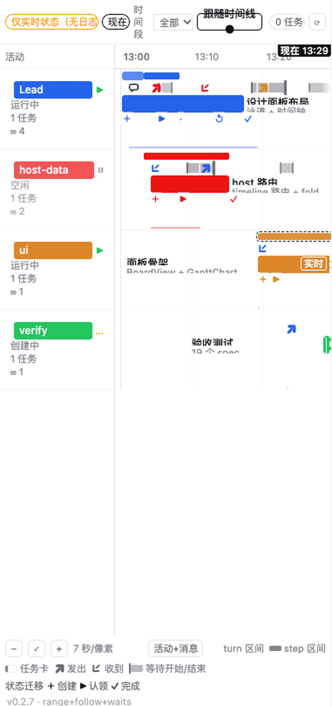

# dsh-task-gantt

**DeepSeek Harness 侧边栏的 agent team 任务甘特图** —— 纵轴每个 teammate 一条泳道，横轴是真实的会话时间，每个共享任务都画出标题与简介。

[English](README.md) | 中文

> **下面的截图是真实面板 + 合成 fixture 数据**（6 条泳道、每条泳道双向消息、两种
> 箭头粗细），由真实浏览器拍摄，存于 `docs/screenshots/panel-v3.png`。之所以标注清楚：
> 画面是**出厂组件**画的，但**数据是 fixture**，所以它不是真机团队数据截图。图里页脚
> 带着构建标识（`v0.2.2`），读者据此可以判断是哪个构建画的。
> 其余截图（真机团队数据的面板全貌、任务卡详情、降级态）仍待补；清单见
> [`docs/SCREENSHOTS.md`](docs/SCREENSHOTS.md)。不会用示意图冒充实拍。



`dsh-task-gantt` 是 [dsh-better-sidebar](https://github.com/ChuanTianML/dsh-better-sidebar) 的插件：它注册一个额外的侧边栏页签。插件是**只读**的 —— 它不会创建、认领或完成任何任务。

---

## 项目状态

| | |
|---|---|
| 版本 | `0.2.8` |
| 冻结契约（`src/shared/contract.ts`） | 已完成 |
| host 数据层（`src/host/**`） | 进行中 |
| 页签注册（`src/client/index.ts`） | 已完成 |
| 甘特图渲染（`src/client/ui/**`） | 进行中 |
| 真机挂载冒烟 | 尚未执行 |

下面描述的是**冻结契约规定的行为**；实际跑过什么、观察到什么，看
[`docs/VALIDATION.md`](docs/VALIDATION.md)（由验证同学维护）—— 本 README 不会把没跑过的
事写成结论。

## 功能

- **泳道 = 名单。** 先是 Lead，再按名单顺序排 teammate，最后是 `unassigned` 行
  （任务还没指派给任何人时落在这里）。
- **真实时间轴。** 每条活动区间、每次任务状态迁移，时间都取自**持久化会话事件日志**
  （epoch 毫秒），不是「面板打开的那一刻」。
- **turn 带 + 内嵌 step 条。** 一整个 prompt/response 回合是浅色带，回合内的每个
  model step 是深色条；还没闭合的区间画成开口并延伸到当前时刻。
- **任务卡承载信息，不只是颜色。** 卡上是 `subject` 加一行 `description`；
  详情里有状态、负责人、`blockedBy`、`writeScopes` 与 `ready`。
- **如实降级。** 拿不到时间的泳道会明说，并把任务标成实时态，而不是编一个区间出来。
- **令牌驱动主题 + 中英双语。** 所有颜色只来自 DSH 的
  `--dsw-alias-*` / `--dsw-font-*` / `--ds-*` 令牌，因此任何皮肤都能用；界面语言跟随
  页面语言自动切换中/英。

## 运行要求

| 要求 | 值 |
|---|---|
| DSH | `0.2.0-rc.2`（本插件的开发基准版本） |
| dsh-better-sidebar | `>= 0.4.0`（引入 `ctx.betterSidebar` 注册表服务的版本） |
| Node | `>= 20` |
| Profile | 任意带浏览器的 DSH Web profile |

插件只声明一个 peer：`@deepseek-ai/cordis@^4.0.0`，且标为 optional。它**故意不声明**
任何 `@deepseek-ai/dsh-*` peer —— 宿主启动预检会评估这些范围，不满足时会静默禁掉整个
profile 行。详见 [`docs/DESIGN.md`](docs/DESIGN.md) §8。

如果没装 `dsh-better-sidebar`，插件照样加载，只打一条 warn 日志，没有页签可注册而已。

## 安装

下面的命令**逐字引用**自 [`docs/INSTALL.md`](docs/INSTALL.md)（owner：packaging）—— 那是这些
命令唯一被写下来的地方，每条命令的完整依据也在那里。

```bash
cd ~/.dsh && dsh plugin --profile web add "github:xx529/dsh-task-gantt"
```

然后重启 `dsh web`，并硬刷新浏览器页面（`Cmd+Shift+R`）。

> **状态：`[not run]`。** `xx529/dsh-task-gantt` 目前还不存在于 GitHub
> （`gh repo view xx529/dsh-task-gantt` → *"Could not resolve to a Repository"*），
> 所以这条命令今天无法端到端跑通。它是照一手依据写的，不是凭印象：`dsh plugin` 把参数
> **原样转发给 pnpm**
> （`~/.nvm/versions/node/v22.22.2/lib/node_modules/@deepseek-ai/dsh/lib/bin.js:96`），
> 而 `github:owner/repo` 正是官方文档给 bundle 插件印的形式
> （[`docs/INSTALL.md`](docs/INSTALL.md) §1.1，同形式已对真实包验证过）。

> ### ⚠️ 不要用别名形式安装
>
> `… add "dsh-task-gantt@github:xx529/dsh-task-gantt"` 也能解析，但包会落在
> `node_modules/<别名>`，而它内部 `package.json` 的 `"name"` 仍是 `dsh-task-gantt`。
> profile 的 `dsh.profile.bundles` 与 Loader row 是按**包名**记账的，两者不一致会退化成
> 「warn, then skip」。请使用上面的无别名形式
> （[`docs/INSTALL.md`](docs/INSTALL.md) §1.1）。

可选前置：面板需要有 **dsh-better-sidebar** 才能注册进去。它被有意地**不**作为本包的依赖。

```bash
cd ~/.dsh && dsh plugin --profile web add dsh-better-sidebar
```

## 卸载

```bash
cd ~/.dsh && dsh plugin --profile web remove dsh-task-gantt
```

之后重启 `dsh web`。

> ⚠️ **`remove` 不会改 patch 层。** 卸载只删依赖，不会移除 `cordis.patch.yml` 里**手工添加**的
> `insert` 行。本插件的 row 来自它自己的 bundle patch（`dsh.bundle.patch` →
> `cordis.patch.yml`），随包一起走，所以理论上不留残渣 —— 但如果你曾手工往
> `~/.dsh/profiles/web/cordis.patch.yml` 加过 `- insert: - id: dsh-task-gantt`，
> 那一行也要删掉（[`docs/INSTALL.md`](docs/INSTALL.md) §5）。

## 使用

### 打开面板

1. 打开一个存在 agent team 的会话（有 teammate，或至少有一个共享任务）。
2. 打开**右侧栏**，点 **`+`**。
3. 选择页签：
   - 中文界面：**任务甘特图**
   - 英文界面：**Task Gantt**

页签声明为 `single: true` —— 官方文档里的单实例语法糖（`single: true` ≡
`dedupeKey: () => id`）：再次打开会聚焦已有页签，而不是叠出第二个。如果你在菜单里看不到
说明文字，那是宿主侧的规则，不是插件的问题 —— 宿主只在新页签列表不超过 4 条时才渲染说明。

### 怎么看这张图

| 元素 | 含义 |
|---|---|
| 泳道头 | 一位名单成员：名字、角色、状态点 |
| 浅色带 | 一整个 turn（`turn/start` … 结算） |
| 深色条 | turn 内的一个 model step（`step/start` … `step/end`） |
| 开口条 | 该区间尚未闭合，右端延伸到「现在」 |
| 竖线 | 当前真实时间 |
| 任务卡 | 一个共享任务，按它被记录下来的时间定位 |
| 带实时标记的任务卡 | 该任务没有可考的时间记录，位置是**当前状态**，不是历史区间 |

悬停或键盘聚焦任务卡可以看到完整 `subject`、`description`、`blockedBy`、
`writeScopes`，以及是否 `ready`。整张图由真实 DOM 元素构成（不用 canvas），文字可选、读屏可达。

### 降级态

面板永远会告诉你这张时间轴是怎么拼出来的。响应里的 `source` 只有三种取值：

| `source` | 含义 | 你会看到 |
|---|---|---|
| `log` | 区间来自可读的持久化会话日志 —— 权威 | 完整时间轴 |
| `partial` | 部分泳道的日志读不到 | 能读的泳道照画，读不到的降级，并给出说明 |
| `live` | 没有任何日志可读，只有投影 | 只画当前状态，明确标注，并给出说明 |

另外两种状态也值得知道：

- **当前会话没有 agent team** —— 空态，暂时没有东西可画。
- **任务板提前中止** —— 显示 Lead 的持久化失败原因（banner）。

任何降级态下，插件都不会发明时间戳。没有历史记录的任务画在当前位置并标为实时态，这是
有意为之。

## 工作原理

这张图由**两个**数据源拼成，缺任何一个都画不出来：

1. **`agentTeam` 会话投影**（浏览器侧）权威地回答「有什么、现在是什么状态」——
   名单、phase，以及共享任务的 status、owner、依赖与写入范围。**它完全没有时间戳**：
   成员记录和任务记录里都没有 `createdAt` / `startedAt` / `completedAt`。它能告诉你
   某个任务 `completed`，但永远无法告诉你**什么时候**完成的。
2. **持久化会话事件日志**（host 侧，Lead 与每个 teammate 各一份）是唯一权威的时钟。
   每条事件带 `time`（epoch 毫秒）与 `seq`。host 半读取日志，把它们折叠成活动区间与
   带时间的任务迁移。

host 半把折叠结果通过一个很小的只读 JSON API 暴露出来
（`POST /dsh-task-gantt/api/timeline`），浏览器半负责渲染。浏览器自己读不了会话日志，
这就是这个拆分存在的原因。

### 任务时间从哪里来

任务状态迁移原则上可能不在日志里留痕，所以插件按顺序尝试三级，取到就停：

1. 日志里有任务相关事件（`team/task`）→ 直接用它的 `time`；
2. 否则扫 `tool/call`，命中共享任务板工具（`team_task_create` / `team_task_update`）
   → 用该次调用的 `time`，并用它的 `expected_revision` 把这次变更归属到真正动手的 teammate；
3. 都没有 → `history` 保持为空，任务按实时态绘制。

**第 1 级是常态，而且是实测过的。** `team/task` 事件写进 **Lead 自己的会话日志**并立即
flush，所以看板刚动过就能读到；六个 teammate 的日志里这类事件是 0 条
（[`docs/FINDINGS-host.md`](docs/FINDINGS-host.md) §1、§4.1–4.2）。第 2 级保留作兜底与归属
通道，因为 `team/task` 只带完整任务快照、**没有 `action` 字段** —— action 必须由 revision
连续性与 status 迁移推导（[`docs/FINDINGS-host.md`](docs/FINDINGS-host.md) §4.4）。

第 3 级是真实存在的结果，不是 bug。详见 [`docs/DESIGN.md`](docs/DESIGN.md) §3。

## 配置项

没有。插件只注册一个页签和一个 HTTP 路由前缀，没有设置界面、没有配置文件、没有环境变量。

## 常见问题

**它会改我的任务吗？**
不会。插件只读，从不调用任务的创建/更新服务。它注册的 HTTP 路由只有同源的
`POST …/timeline` 与 `POST …/ping`。

**某个显然跑过的任务为什么没有条？**
因为它的状态迁移没有被任何可读的会话日志记录下来（上面的第 3 级）。任务仍会画在当前位置
并标为实时态，而不是被放到一个猜出来的时间点上。

**为什么页签没出现？**
要么这个 profile 没有挂载 `dsh-better-sidebar`，要么插件行没有生效。确认插件出现在
profile 的 `dsh.profile.bundles` 里，然后重启 `dsh web`。

**没有 agent team 的 profile 能用吗？**
能，会显示空态。插件用 `ctx.get(...)` 探测它需要的每个服务，不依赖 agent-team 层即可激活。

**换皮肤还能用吗？**
应该能。面板只消费 DSH 主题令牌（`--dsw-alias-*`、`--dsw-font-*`、`--ds-*`），零颜色
字面量，并且有测试守着。

## 开发

```bash
pnpm install
pnpm run typecheck     # tsc --noEmit，必须 0 error
pnpm run test          # vitest
pnpm run build         # 产出 lib/index.js（host 半）+ lib/client.js（浏览器半）
```

`lib/` 是**故意提交进仓库**的：插件从 GitHub 直装、没有构建步骤，所以发布产物必须在仓库
里 —— CI 也会检查它是否是最新的。

想用本地检出直接挂到 profile（而不是装一份拷贝），逐字引用自
[`docs/INSTALL.md`](docs/INSTALL.md) §1.2：

```bash
cd ~/.dsh && dsh plugin --profile web add "link:/Users/lzx/Documents/GitHub/dsh-task-gantt"
```

设计文档与数据源取舍：[`docs/DESIGN.md`](docs/DESIGN.md)。
上架材料：[`docs/MARKET.md`](docs/MARKET.md)。
已经实际验证过的内容：[`docs/VALIDATION.md`](docs/VALIDATION.md)。

## 许可

MIT —— 见 [`LICENSE`](LICENSE)。
